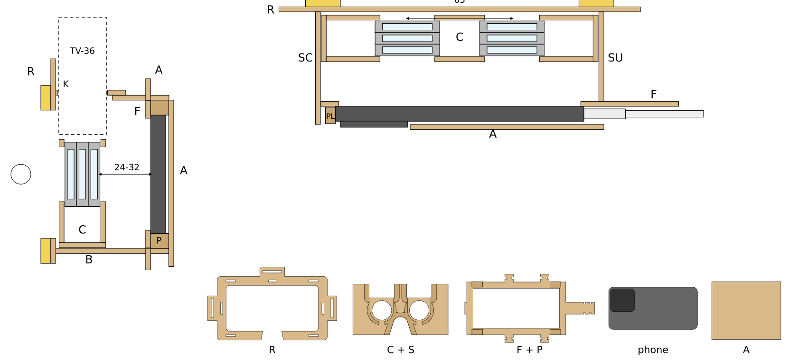

# Cardboard headset: iPhone 16 Pro + two Carson TriView TV-36

A flat-pack cardboard box that holds the phone, two whole TV-36 magnifiers set to **5.5x** (top and bottom lenses swung out, middle lens left in the case; cases sticking up through the top) and a strap. Print `template.pdf`, stick the pages on corrugated card, cut, slot together, tape.

**Time:** about 2 to 2.5 hours with 2 or 3 people (1 h cutting in parallel, 40 min assembly, 30 min fitting and focus). About 3.5 hours alone.

Left: side section through one lens (eye on the left). Right: section from above. Bottom: the layers from the face to the back.

| ID | Part | Count | Page |
| --- | --- | --- | --- |
| A | Top wall with the back flap | 1 | 1 |
| P, PL | Phone pocket blocks | 16, 2 | 1 |
| B | Bottom wall | 1 | 2 |
| SC, SU | Side walls, camera end and USB end | 1 each | 2 |
| K | Covers for the magnifier notches | 4 | 2 |
| R | Face ring with the strap ears | 1 | 3 |
| F | Screen frame with band hooks and the cable tab | 1 | 4 |
| C | Lens carrier (folds into an open-top box) | 1 | 5 |
| S | Lens seats | 2 | 6 |

## Materials

- Corrugated card, **3 mm thick** (a normal shipping box), flat and uncreased: about 3 Letter-size sheets' worth. The template assumes 3 mm. Measure yours: for anything from 2 to 4 mm that isn't 3, regenerate with `python3 gen.py --t <thickness>`.
- 6 printed pages (`template.pdf`), glue stick or spray glue to stick them down.
- Packing tape or duct tape. Hot glue or white glue if you have it.
- 2 rubber bands, about 90 mm long laid flat (size 33 or 64). Unmeasured: see step 8.
- Foam: about 10 mm thick for the face (weatherstrip, packing foam, a sponge), 2 to 3 mm for the phone pads (craft foam, felt, or folded paper towel).
- Elastic or webbing strap, 32 mm wide or less. A second piece for over the head.
- A twist tie, zip tie or a third rubber band for the cable.

## Tools

Craft knife with fresh blades, metal ruler, cutting mat (or scrap card), pencil, calipers or a ruler.

## Lines on the template

- **Solid:** cut all the way through.
- **Dash-dot (mountain fold):** cut through the paper and the top layer of the card only, then fold away from the printed side. Only C and A's flap have folds.
- **Dashed (valley fold):** not used on this template.
- **Grey dotted (guide):** don't cut. Foam pad positions and the focus scale.

The printed side is always the **outside** of the finished headset. Leave the paper on: CAM, USB, FRONT and TOP tell you which way round each part goes.

Fold lines need no allowance: with the top layer cut, the card hinges on its inner face, so the distance between two fold lines is the inside size. Card thickness sets the tab lengths, the slot widths (thickness + 0.3 mm) and the block stacks (three layers = 9 mm).

## Step 1. Bench focus test (10 min, before cutting)

The focal length of the stacked magnifier is an estimate, and this test replaces it with a number.

1. Set one magnifier to **5.5x**: swing out the top and bottom lenses only, middle lens stays in the case (manual). Carson logo toward your eye.
2. Lay the phone flat showing small text at full brightness.
3. Hold the stack over the text with your eye about 2 cm above it. Start touching the screen and lift until the text is sharp and comfortable, not just readable.
4. Have someone measure the gap from the screen to the bottom face of the lens stack. Write it down: this is **d**.

**Already measured (2026-11-14, 5.5x): d ≈ 30 mm** (bottom of the bottom lens to the screen; top of the top lens at 50 mm), eye right at the top lens. The template covers d from 24 to 32 mm, and at d = 30 the stack sits 2 mm short of the front, so the eyes are as close as the face ring and foam allow. Re-check with the method below only if a different person's eyes disagree.

- **d between 12 and 30:** carry on.
- **To bring the eyes closer:** regenerate with `python3 gen.py --d-max <d + 1>`. The carrier then sits flush with the front at your d.
- **d outside 24 to 32:** regenerate with `--d-min` / `--d-max` around your number.

## Step 2. Print, check, stick, cut (about 1 h, split the pages between people)

1. Print `template.pdf` on US Letter at **100% / actual size**, not "fit to page".
2. Measure the **50 mm bar** at the bottom of every page. If it isn't 50 mm (±0.5), fix the print settings and reprint.
3. Cut roughly around each part and glue it to the card. Run the card's flutes along the long side of each part.
4. Cut the inside shapes first (slots, windows, lens holes), then the outline. Several light passes, new blade when it starts tearing.
5. Test one slot with an offcut of your card: it should push in snug. Widen slots with the knife if not.

Cut in this order so assembly can start early: C and S, then F and B, then SC, SU, A, R, then P, PL and K.

## Step 3. Lens carrier: C + S

1. Score C's four dash-dot lines (top layer only). Fold both plates up from the floor, printed side out, and fold the two end flaps back.
2. Tape each end flap to the side edge of the REAR plate. The plates should stand parallel, 22 mm apart inside.
3. Glue one S inside the FRONT plate and one inside the REAR plate: bottom edge on the floor, centred side to side. The round bottoms of the S cutouts sit around the lens holes.

## Step 4. Fit the magnifiers to the carrier

Everything about the magnifier except the rim diameter (38.75) and stack thickness (21.09) is unmeasured, so the cutouts are oversized or meant to be trimmed.

1. Set both magnifiers to 5.5x (top and bottom lenses out, middle lens in the case). Lower each into the carrier, case pointing up: the rims drop into the S seats, the thumb tabs into the small notches below them.
2. Trim until each stack sits all the way down:
    - Rim won't go in: shave the round part of the S seat.
    - Thumb tabs hit: enlarge the notch under the seat.
    - Neck, hinge or case hits a plate or seat: mark where with a pencil and widen or deepen the top notch there.
3. Shim anything loose: tape or paper strips on the seat walls for sideways play, a strip of thin card behind the stack for front-to-back play.
4. Look through each: the glass should be centred in the 33 mm hole. Measure glass centre to glass centre: **63 mm**.

Take the magnifiers out again.

## Step 5. Body: B, F, SC, SU, carrier, A, R

1. Lay **B** printed side down, FRONT edge toward you.
2. Push **F**'s two bottom hooks through B's slots. F's printed side faces the back; its long cable tab is at the USB end.
3. Slide **SC** onto F's short tab (CAM end) and **SU** over the long tab (USB end). Their FRONT tabs point forward.
4. Set the **carrier** in front of F, FRONT plate forward, floor down. It should slide front to back with light friction. Too tight: shave the end flaps.
5. Lower **A** on, printed side up, so F's top hooks come through its slots. The flap hangs off the back.
6. Push **R** onto the seven front tabs, TOP ear up.
7. Square everything up, then tape all four long corners end to end, and tape or glue R to the walls all the way round. Keep tape off the two magnifier notches and the hook notches.
8. Score the flap's dash-dot line, fold the flap down over the back, and run a strip of tape along the inside of the hinge.

## Step 6. Phone pocket blocks: P, PL

The phone must touch card only at the last 18 mm of each long edge, so nothing presses a side button. **Unmeasured:** check on your phone that no button lies in those 18 mm, and shorten the blocks if one does.

1. Glue the blocks into stacks: four stacks of 3 P, two stacks of 2 P, one stack of 2 PL.
2. All stacks touch the back of F. Glue them in:
    - **USB end:** two 3-stacks on the SU wall, one just above and one just below the plug notch, long side upright.
    - **Bottom:** two 3-stacks on the floor, under the two ends of the phone.
    - **Top:** two 2-stacks on the ceiling, over the two ends of the phone, with foam on them to fill the last 3 mm.
    - **Camera end:** the PL stack on the SC wall at mid height, with foam on it.
3. Put the phone in, screen forward, camera at the CAM end, pushed against the USB-end stacks. It should be snug but slide out. Move blocks or add foam until it doesn't rattle.
4. Look through F's window from the front: the whole lit screen must be visible and no card may lie on it. Trim the window if needed; never make it smaller.

## Step 7. Magnifiers in, focus, lock: K

1. Drop both magnifiers through A's notches into the carrier, Carson logo toward the face.
2. Put the phone in showing the app's test mode (or any small text), close the flap by hand and look through.
3. Push the carrier forward or back by the cases until the picture is sharp with relaxed eyes. Read the **scale** on A beside the left notch: the number level with the back face of the lens stack is d. It should match step 1.
4. Lock it: trim two **K** pieces per magnifier so they fill the notch in front of and behind the case, and tape them flat onto A. They block light and stop the carrier sliding.
5. Tape or band the two cases together above the headset so they can't rock.
6. In the iPhone app's lens settings, set screen-to-lens to **d + 10 mm** (the middle of the 5.5x pair, about 20 mm deep): **≈ 40 mm** at d = 30.

## Step 8. Phone, cable, flap, bands

1. Stick thin foam pads inside the flap at the four dotted squares. Add layers until the closed flap presses the phone lightly.
2. Plug the USB-C cable in first. Lower the phone in from the back: the plug drops into SU's notch.
3. Lay the cable along the back of F's cable tab and tie it at the two pairs of notches, leaving a little slack between the plug and the first tie. **Unmeasured:** if your plug's body is wider than 13 mm or longer than about 25 mm, widen the notch or tie further out.
4. Close the flap. Hook a rubber band over each top hook, down across the flap, onto the bottom hook. **Unmeasured:** the bands should be firm, not crushing. Double a band that's too long.
5. The camera end of the phone stays outside the flap on purpose.

## Step 9. Foam and straps

1. Stick a band of foam about 12 mm wide and 10 mm thick all the way round R's front, including the edges of the nose gap.
2. Thread the head strap through the two side ears and the over-head strap through the top ear. Wrap tape around each ear first: it stops the slot tearing.
3. Try it on. Nose pinched: enlarge the nose gap in R and B. Light at the cheeks or brow: add foam there.

## Step 10. Final check

- [ ] Rear camera completely uncovered, nothing within a finger's width of it.
- [ ] No card or foam touching a side button; nothing on the lit screen.
- [ ] USB-C plugged in, tied down, and the plug doesn't move when you tug the cable.
- [ ] Shake test: phone and magnifiers don't shift.
- [ ] Dark-room test with the screen off: no light leaks at the corners, the notches (K) or around R. Tape over any.
- [ ] Both eyes sharp and the two images merge. If they don't merge, check the 63 mm lens spacing and that both stacks sit fully down.
- [ ] Keep sessions to about 5 minutes: the phone has little airflow in there.

## Unmeasured dimensions

| What | Template assumes | How to get the real one | Step |
| --- | --- | --- | --- |
| Focus distance d (rear lens face to screen) | 24 to 32 mm of travel (measured ≈ 30 at 5.5x) | Bench focus test | 1, 7 |
| Magnifier neck, hinge and case outline | 43 mm wide notches (case is 40.6 in the manual) | Lower it in, pencil-mark, trim | 4 |
| Case thickness beyond the lens stack | Open notches in the plates above the lenses | Same | 4 |
| Thumb tabs | 10 × 5 mm notch under each seat | Same | 4 |
| Button-free length at the phone's ends | 18 mm | Look at the phone, shorten blocks | 6 |
| USB-C plug body | 13 × 8 mm, 25 mm long | Hold the plug to SU's notch, widen | 8 |
| Camera bump width across the phone | Whole camera end left open | Nothing to do | 8 |
| Phone foam | 2 mm squeezed | Add or remove layers | 6, 8 |
| Face foam | 10 mm thick, 6 squeezed | Use what you have; thinner brings the eyes closer | 9 |
| Rubber band length | About 90 mm flat | Try, double if loose | 8 |
| Card thickness | 3 mm | Calipers; `gen.py --t` | 2 |

## Regenerating

`python3 gen.py [--t 3] [--d-max 30] [--d-min 12]` rewrites the template, previews and overview, and checks the key sizes in the written SVG (needs `shapely` and `rsvg-convert`). `uv run --with weasyprint --with markdown instructions_pdf.py` rebuilds `instructions.pdf`.
